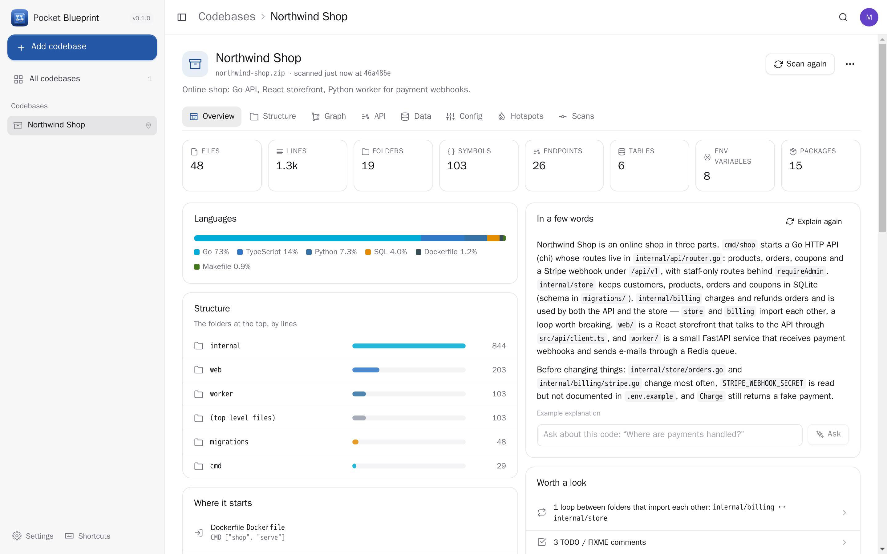
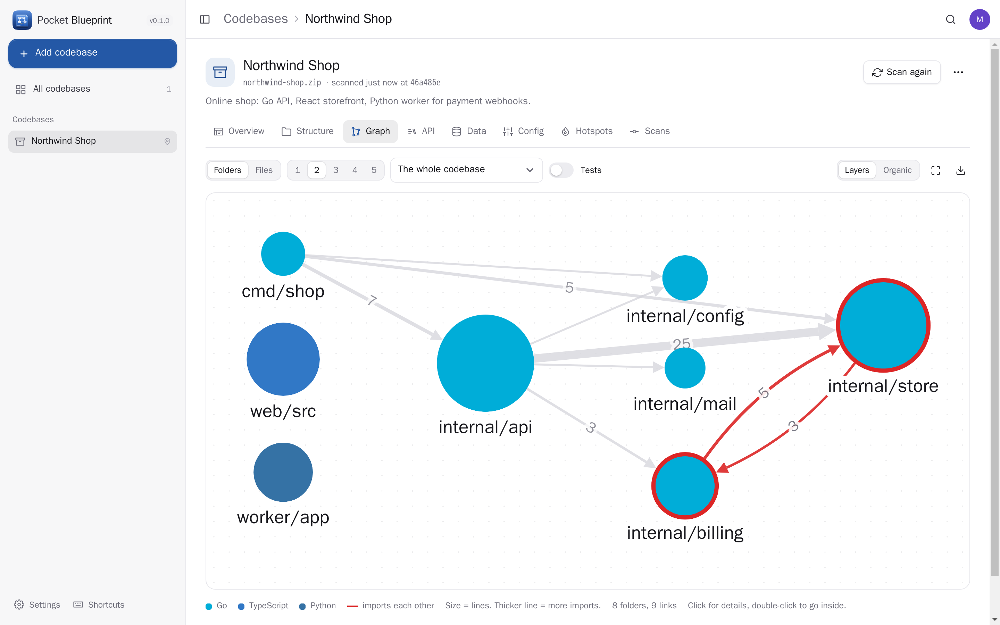
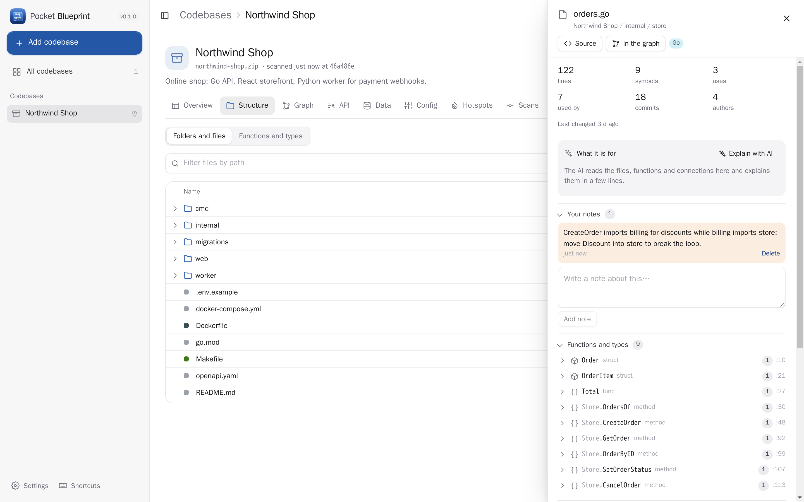
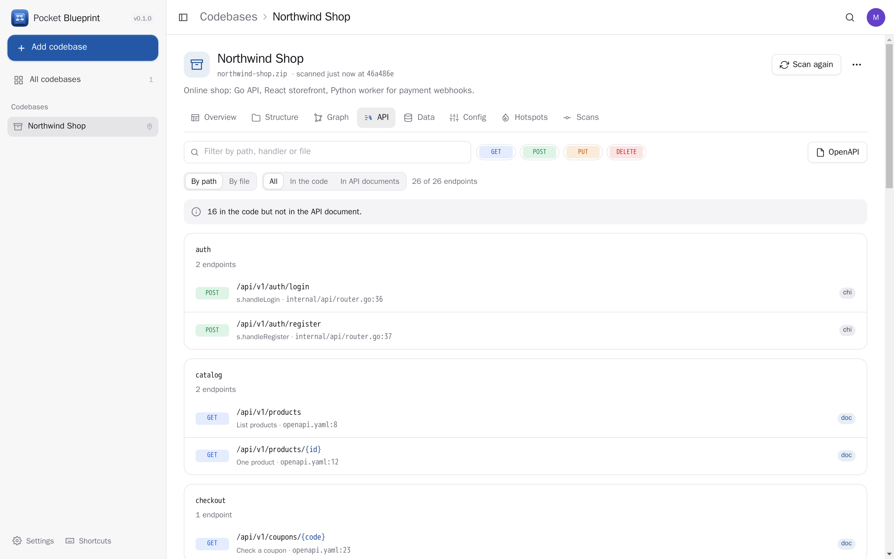
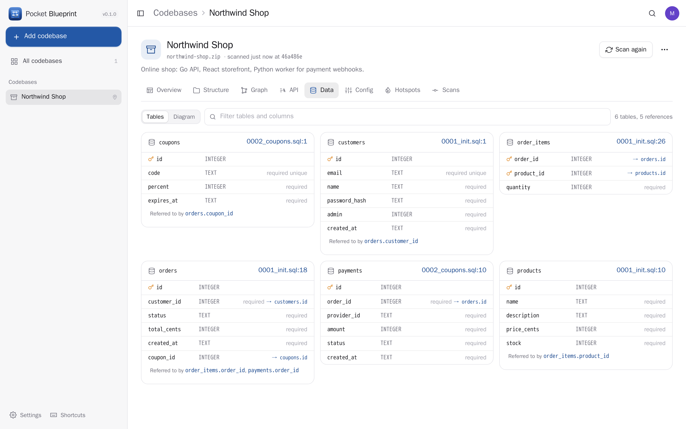
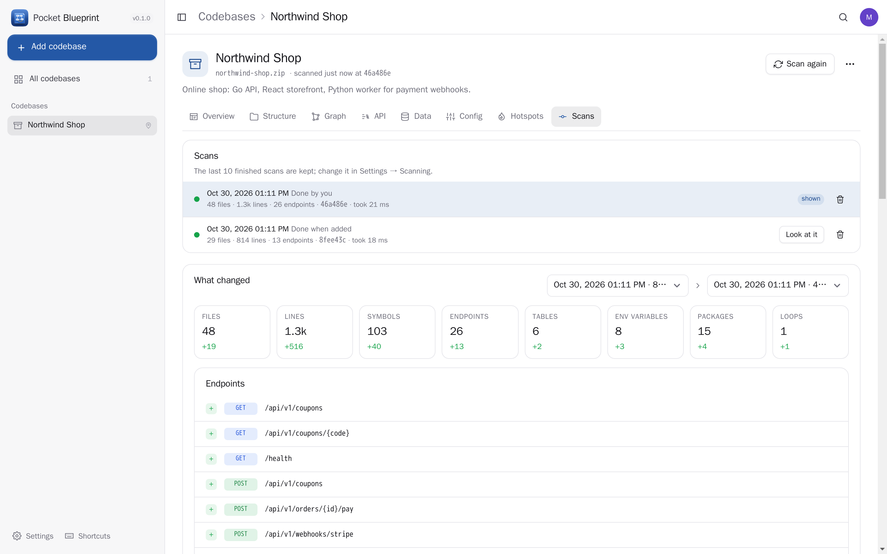
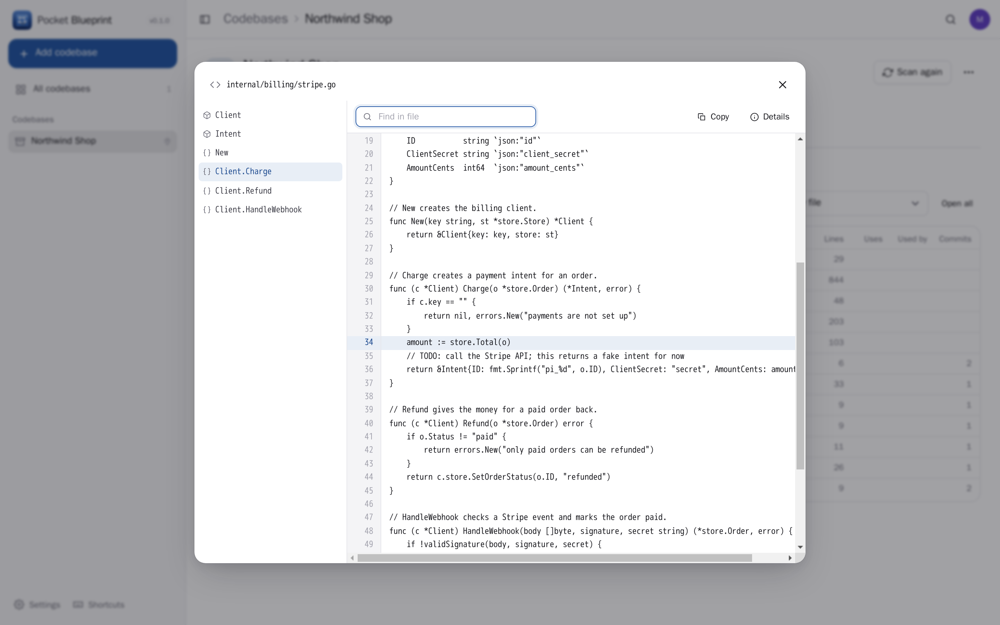
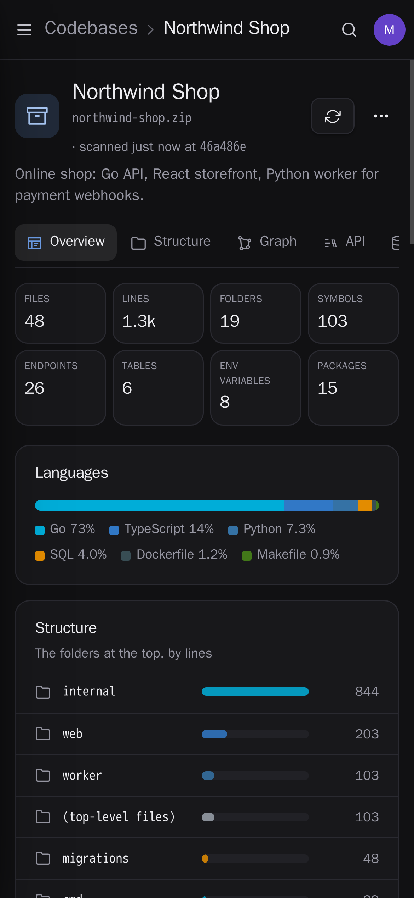
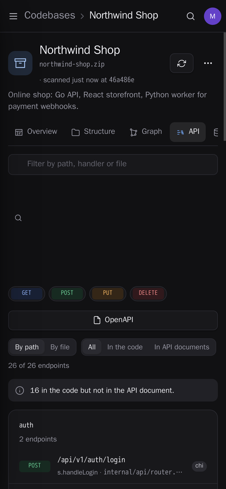
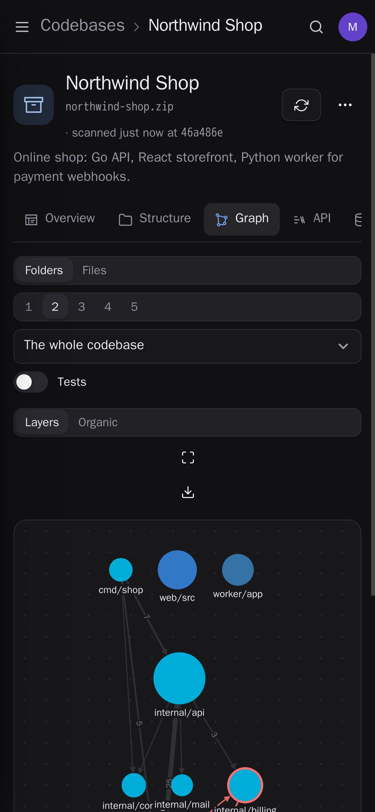

<p align="center"></p>
<h1 align="center">Pocket Blueprint</h1>
<p align="center">See how a codebase is built. Point it at a git repository, an archive, a folder on your server or a folder in Pocket Files, and get its structure, a graph of which folder and file uses which (loops in red), the functions and types with who calls what, every HTTP endpoint with a ready OpenAPI document, the database tables from the migrations, the environment variables (and which ones nobody documented), the services, and the files that change most. Compare two scans, keep notes on any file, and let the AI explain a folder.<br>One Go binary, one SQLite file, one volume. Part of the Pocket apps; works on its own too.</p>
<p align="center">
  <a href="https://github.com/abjelosevic88/pocket-homelab-blueprint/actions"></a>
  <a href="https://github.com/abjelosevic88/pocket-homelab-blueprint/pkgs/container/pocket-homelab-blueprint"></a>
  <a href="LICENSE"></a>
</p>

---

<p align="center"></p>

<table>
  <tr>
    <td width="50%"></td>
    <td width="50%"></td>
  </tr>
  <tr>
    <td align="center"><sub>Which folder imports which — or file by file, around one file, a few levels deep. Loops are red.</sub></td>
    <td align="center"><sub>The tree with sizes and connections; any file or folder opens with its functions, callers, imports and notes.</sub></td>
  </tr>
  <tr>
    <td width="50%"></td>
    <td width="50%"></td>
  </tr>
  <tr>
    <td align="center"><sub>Every endpoint, from the routes in the code and the API documents in the folder — and an OpenAPI document of all of them.</sub></td>
    <td align="center"><sub>Tables from the migrations, in order, with keys and references — as a list or a diagram.</sub></td>
  </tr>
  <tr>
    <td width="50%"></td>
    <td width="50%"></td>
  </tr>
  <tr>
    <td align="center"><sub>What changed between two scans: endpoints, tables, files, packages, variables.</sub></td>
    <td align="center"><sub>The source with its outline, straight from any symbol, endpoint or search result.</sub></td>
  </tr>
</table>

<p align="center">  </p>

## What it reads

| | |
|---|---|
| **Go** | Read with the Go parser itself: packages and imports (multi-module repos too), functions, methods, types with their doc comments, **who calls what**, routes of chi (nested `Route`/`Group`/`Mount`), gin, echo, fiber, gorilla/mux and `net/http` (Go 1.22 patterns), `os.Getenv` and `env("X", "default")` helpers |
| **TypeScript / JavaScript** | Imports resolved with `tsconfig` paths (`@/…`), functions, classes, React components; Express, Fastify, Hono, Koa, NestJS, Next.js app and pages routes; `process.env`, `import.meta.env` |
| **Python** | Relative and absolute imports, functions and classes; FastAPI (with router prefixes), Flask, Django URLs; `os.environ` / `os.getenv` |
| **Also** | Rust (axum, actix), Java and Kotlin (Spring), C# (ASP.NET), PHP (Laravel), Ruby (Rails routes) — symbols and routes |
| **Documents** | OpenAPI 3 / Swagger 2, SQL migrations (`CREATE`/`ALTER TABLE`, in order), Prisma schemas, docker compose services, Dockerfiles, Makefiles, `.env.example` |
| **Packages** | go.mod, package.json, requirements / pyproject, Cargo.toml, composer.json, Gemfile, .csproj, pom.xml — with versions, and which files really import them |
| **History** | `git log`: commits, authors and last change per file → the hotspots (big files that change often) |

Nothing from the code is ever run. Go is exact; the other languages are read with careful patterns, which covers the usual ways of writing them.

## Where the code comes from

- **Git repository** — any https address (GitHub, GitLab, Forgejo, Gitea…), a branch, a subfolder, a read-only token for private ones. Cloned shallow (only the history it needs) and updated on every scan.
- **Archive** — a `.zip`, `.tar.gz` or `.tar` (GitHub's "Download ZIP" works; include `.git` to see the history).
- **Pocket Files** — pick a folder; a fresh copy is fetched on each scan through a Pocket Core link.
- **Server folder** — read in place, for admins, only inside `SOURCE_ROOTS`.

Any codebase can scan again on its own (every 6 hours, day or week), or from CI: `POST /api/v1/codebases/{id}/scan` with a token.

## Run it

```sh
docker run -d --name pocket-blueprint -p 8080:8080 -v ./data:/data \
  -e ADMIN_EMAIL=you@example.com -e ADMIN_PASSWORD=change-me-please \
  ghcr.io/abjelosevic88/pocket-homelab-blueprint:latest
```

To scan folders on the server, mount them read-only and list them: `-v ~/code:/code:ro -e SOURCE_ROOTS=/code`. See [docker-compose.yml](docker-compose.yml), [docs/configuration.md](docs/configuration.md), [docs/api.md](docs/api.md), [docs/backup.md](docs/backup.md) and [docs/reverse-proxy.md](docs/reverse-proxy.md). Try it with demo data: `make run` (a small shop with a Go API, a React storefront and a Python worker, scanned twice).

## With Pocket Core

Everything works on its own. With [Pocket Core](https://github.com/abjelosevic88/pocket-homelab-core) (`CORE_URL`):

- **Sign in with Pocket Core**, one account for every Pocket app.
- **Pocket Files**: scan folders you keep there, nothing to paste.
- **Pocket AI** explains folders and files and answers questions about a codebase (or use your own OpenAI-compatible key).
- **Other apps read your scans** (`blueprint:read`) and can add a repository and start a scan (`blueprint:write`) — switched on per app in Core → Links. Pocket AI can look up where an endpoint lives or who calls a function instead of reading a whole repository.
- Events `blueprint.scan_finished` and `blueprint.scan_failed` for automations.

## Develop

```sh
make dev     # API on :8080 with demo data + Vite on :5173
make test    # go vet + go test + tsc
make build   # one binary with the UI inside
```

Go 1.26 (no CGO, modernc SQLite), React 19 + Vite, Cytoscape for the graphs. MIT licence.
